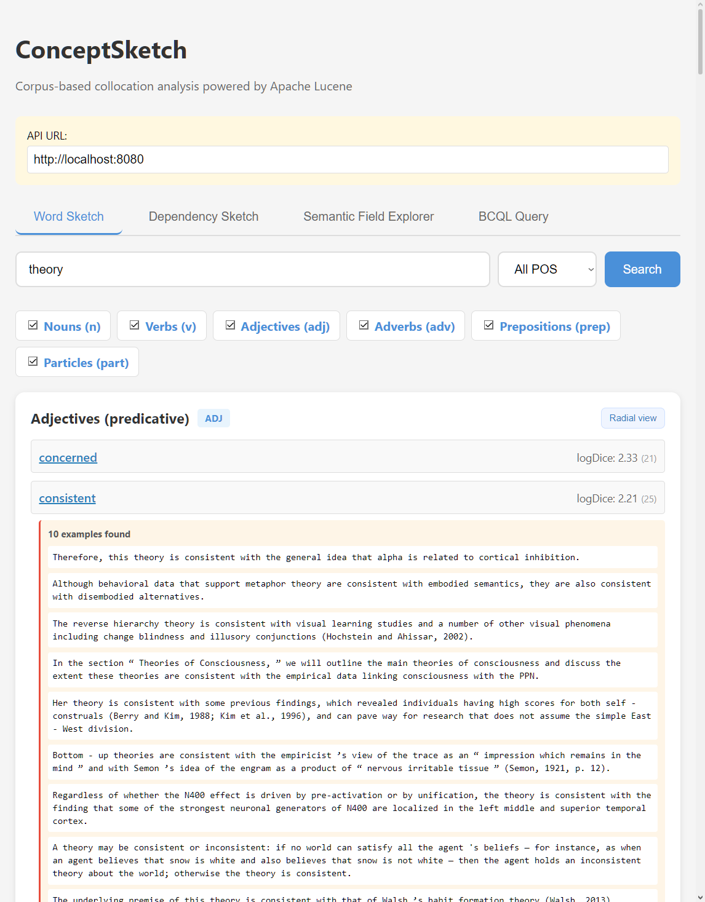
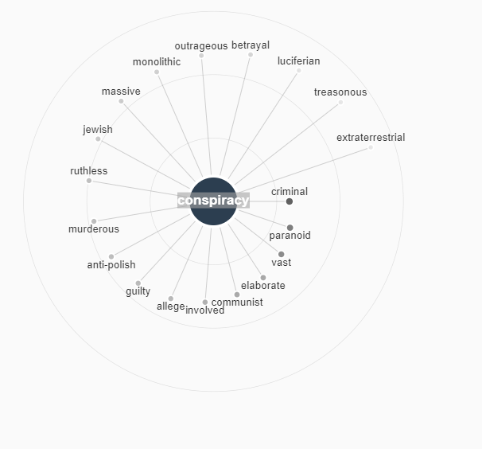
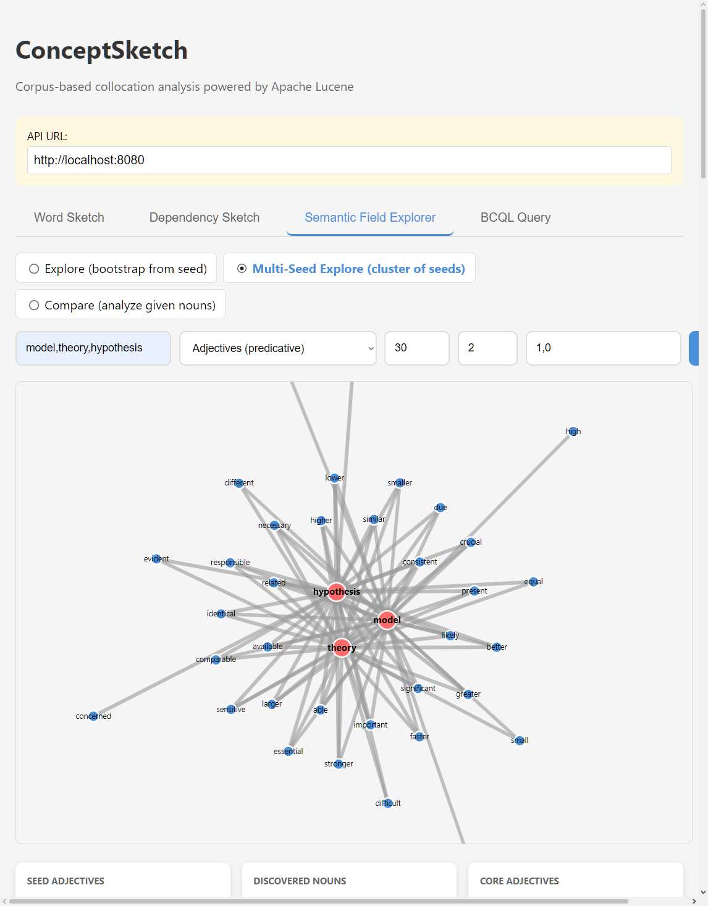

# ConceptSketch

A high-performance corpus-based collocation analysis tool built on [BlackLab](https://blacklab.ivdnt.org/) corpus search software (which relies on Apache Lucene). This project implements word and dependecy sketch functionality (grammatical relations and collocations), semantic field exploration, and conceptual mining for corpus linguistics research and NLP applications.

## Features

- **Fast Collocation Analysis**: O(1) instant lookup with precomputed collocations
- **BCQL Grammar**: 40+ grammatical relations defined as BCQL numbered-label patterns (`1:`, `2:`), covering surface patterns and dependency relations
- **logDice Scoring**: Association strength metric (0-14 scale)
- **Dependency Sketches**: 20 dependency-based relations (nsubj, obj, amod, obl, conj, etc.) leveraging CoNLL-U dependency parses
- **Concordance Examples**: View real corpus sentences for any word pair with highlighting
- **REST API**: HTTP server with 14+ endpoints for sketches, semantic field exploration, concordance, and visualization
- **Web Interface**: Interactive Semantic Field Explorer with D3.js visualization
- **Multi-Seed Exploration**: Explore semantic fields using multiple seed words

## Quick Start (5 minutes)

### Prerequisites

- Java 17+ (Java 21+ recommended)
- Maven 3.6+
- Python 3 (for web server)

### 1. Build

```bash
mvn clean package
```

## Corpus Data for Testing

You can test ConceptSketch by downloading this indexed and tagged corpus:

- Frontiers in Psychology Corpus, <https://doi.org/10.18150/4LJ9WD>

It is sufficiently large to provide interesting insights about the language of contemporary psychology (2010-2021, before the advent of AI-generated papers).

### 2. Create an Index

#### Step 1 — Prepare a CoNLL-U corpus

Tag your text with any CoNLL-U-producing tool. The project includes a **Stanza GPU script** for efficient tagging:

**Option A: Use the Stanza script (recommended)**

```bash
# Download model (one-time)
python tag_with_stanza.py --download --lang en

# Tag corpus (uses GPU automatically if available)
python tag_with_stanza.py \
  --input corpus.txt \
  --output corpus.conllu \
  --lang en
```

For GPU tuning and more options, see [STANZA_GPU.md](STANZA_GPU.md).

**Option B: Use UDPipe 2 directly**

```bash
udpipe --tokenize --tag --parse --output=conllu english.udpipe corpus.txt > corpus.conllu
```

**Option C: Use another CoNLL-U tagger** (Stanza in Python without GPU, spaCy, etc.)

#### Step 2 — Preprocess: add `<s>` sentence markers

BlackLab's tabular parser requires explicit inline tags for sentence boundaries.
The project ships a script that converts CoNLL-U blank-line sentence boundaries
into `<s>` / `</s>` inline tags:

```bash
python scripts/conllu_to_wpl.py corpus.conllu corpus_s.conllu
```

Move the output file into a dedicated input directory:

```bash
mkdir input_dir
mv corpus_s.conllu input_dir/
```

#### Step 3 — Index with BlackLab

The shaded JAR bundles BlackLab's `IndexTool`. Run it from the project root
(so `--format-dir .` can find `conllu-sentences.blf.yaml`):

```bash
java -cp target/concept-sketch-1.6.0-shaded.jar \
  nl.inl.blacklab.tools.IndexTool create \
  --format-dir . \
  my_index/ input_dir/ conllu-sentences
```

| Argument | Meaning |
|----------|---------|
| `--format-dir .` | Directory containing `conllu-sentences.blf.yaml` |
| `my_index/` | Output index directory (created automatically) |
| `input_dir/` | Directory with preprocessed `.conllu` files |
| `conllu-sentences` | Format name (matches the `.blf.yaml` filename) |

### 3. Start API Server

```bash
# Terminal 1
java -jar target/concept-sketch-1.6.0-shaded.jar server --index my_index/ --port 8080
```

> **CORS configuration**: By default the API allows requests from `http://localhost:3000`.
> To allow a different origin, pass the `cors.allow.origin` JVM system property:
> ```bash
> java -Dcors.allow.origin=https://myapp.example.com \
>      -jar target/concept-sketch-1.6.0-shaded.jar server --index my_index/ --port 8080
> ```

Server startup output:
```
API server started on port 8080
Endpoints:
  GET  /health
  GET  /api/sketch/{lemma}
  GET  /api/sketch/{lemma}/{relation}
  GET  /api/sketch/{lemma}/dep
  GET  /api/sketch/{lemma}/dep/{deprel}
  GET  /api/relations
  GET  /api/relations/dep
  GET  /api/semantic-field/explore
  GET  /api/semantic-field/explore-multi
  GET  /api/semantic-field/compare
  GET  /api/semantic-field/examples
  GET  /api/concordance/examples
  POST /api/visual/radial
  POST /api/bcql
```

### 4. Start Web Interface

```bash
# Terminal 2
python -m http.server 3000 --directory webapp
```

Open browser to: **http://localhost:3000**



The web interface allows to produce some radial plots for collocates:



And you use some semantic exploration features:



### 5. Try a Query

```bash
# Find adjectives describing "house"
curl "http://localhost:8080/api/sketch/house"

# Get example sentences for "house" + "big"
curl "http://localhost:8080/api/concordance/examples?seed=house&collocate=big&top=5"

# Explore semantic field from "theory" (noun_adj_predicates, alias "adj_predicate")
curl "http://localhost:8080/api/semantic-field/explore?seed=theory&relation=adj_predicate"

# Multi-seed exploration
curl "http://localhost:8080/api/semantic-field/explore-multi?seeds=theory,model,hypothesis&top=10"
```

---

## Core Usage

### Index a Corpus

#### Prerequisites
- A corpus in **CoNLL-U format** (columns: ID, FORM, LEMMA, UPOS, XPOS, FEATS, HEAD, DEPREL, DEPS, MISC)
- The project's `conllu-sentences.blf.yaml` format file (in the project root)
- Java 21+ and the shaded JAR (`target/concept-sketch-1.6.0-shaded.jar`)

#### Step 1 — Preprocess CoNLL-U: add sentence markers

BlackLab's tabular parser needs explicit `<s>` / `</s>` inline tags to index
sentence spans. The bundled script converts CoNLL-U blank-line boundaries:

```bash
python scripts/conllu_to_wpl.py corpus.conllu corpus_s.conllu
```

What the script does:
- Skips comment lines (`#`) and multi-word token lines (`1-2`, `1.1`, …)
- Emits `<s>` before the first token of each sentence
- Emits `</s>` after the last token
- Preserves all 10 CoNLL-U columns as tab-separated values

#### Step 2 — Create a BlackLab index

```bash
mkdir input_dir
cp corpus_s.conllu input_dir/

# Run from the project root (so --format-dir finds conllu-sentences.blf.yaml)
java -cp target/concept-sketch-1.6.0-shaded.jar \
  nl.inl.blacklab.tools.IndexTool create \
  --format-dir . \
  my_index/ input_dir/ conllu-sentences
```

To add more documents to an existing index later:

```bash
java -cp target/concept-sketch-1.6.0-shaded.jar \
  nl.inl.blacklab.tools.IndexTool add \
  --format-dir . \
  my_index/ more_input_dir/ conllu-sentences
```

#### Indexed annotations

| Annotation | Source column | Forward index |
|------------|--------------|---------------|
| `word`     | FORM (col 2) | ✓ |
| `lemma`    | LEMMA (col 3) | ✓ |
| `pos`      | UPOS (col 4) | ✓ |
| `xpos`     | XPOS (col 5) | ✓ |
| `deprel`   | DEPREL (col 8) | ✓ |
| `wordnum`  | ID (col 1) | — |
| `feats`    | FEATS (col 6) | — |
| `head`     | HEAD (col 7) | — |

### Query via Command Line

```bash
# Find all collocations for "theory"
java -jar target/concept-sketch-1.6.0-shaded.jar \
  blacklab-query --index my_index/ --lemma theory

# Find adjectival modifiers of "theory" (deprel=amod)
java -jar target/concept-sketch-1.6.0-shaded.jar \
  blacklab-query --index my_index/ --lemma theory --deprel amod
# Increase result count and filter by logDice
java -jar target/concept-sketch-1.6.0-shaded.jar \
  blacklab-query --index my_index/ --lemma theory \
  --deprel nsubj --limit 50 --min-logdice 4.0
```

### Grammar Configuration

The grammar configuration is externalized in JSON. Relations use **BCQL numbered-label patterns**
where `1:` marks the head word and `2:` marks the collocate.

**Config file:** `grammars/relations.json` (version 2.0)

```json
{
  "version": "2.0",
  "description": "BCQL grammar — positions derived from numbered labels (1: = head, 2: = collocate)",
  "bcql": true,
  "relations": [
    {
      "id": "noun_adj_predicates",
      "name": "Adjectives (predicative)",
      "description": "Adjective predicates with copula (e.g., 'hypothesis is valid')",
      "pattern": "1:[xpos=\"NN.*\"] [lemma=\"be|appear|seem|...\"] 2:[xpos=\"JJ.*\"]",
      "relation_type": "SURFACE",
      "dual": false
    },
    {
      "id": "noun_modifiers",
      "name": "Modifiers (adjectives)",
      "description": "Adjectives modifying nouns (e.g., 'big house')",
      "pattern": "2:[xpos=\"JJ.*\"] 1:[xpos=\"NN.*\"]",
      "relation_type": "SURFACE",
      "dual": false
    },
    {
      "id": "dep_nsubj",
      "name": "Dependency: nominal subject",
      "description": "Verb with its nominal subject (e.g., 'theory explains')",
      "pattern": "2:[xpos=\"NN.*\" & deprel=\"nsubj\"] 1:[xpos=\"VB.*\"]",
      "relation_type": "DEP"
    },
    ...
  ]
}
```

**Fields:**
| Field | Description |
|-------|-------------|
| `id` | Unique relation identifier (used in API queries) |
| `name` | Human-readable display name |
| `description` | Natural-language explanation of the relation |
| `pattern` | BCQL pattern with `1:` (head) and `2:` (collocate) positional labels |
| `relation_type` | `SURFACE` or `DEP` (dependency-based) |
| `dual` | (optional) `true` for head/collocate-symmetric relations |

**Pattern syntax:**
- `1:[xpos="NN.*"]` — head word must be a noun (XPOS tag)
- `2:[xpos="JJ.*"]` — collocate must be an adjective
- `[lemma="be|appear|..."]` — intervening copula (positional label omitted = not counted as head or collocate)
- `[xpos="NN.*" & deprel="nsubj"]` — constraints combined with `&`

**API endpoint:**

To view active relations, use `GET /api/relations` (surface) and `GET /api/relations/dep` (dependency).

To modify relations or add new ones, edit `grammars/relations.json` and restart the server.

### REST API Endpoints

#### Health Check
```bash
curl http://localhost:8080/health
```

#### Get Word Sketch
```bash
curl "http://localhost:8080/api/sketch/house"
```

To filter a full sketch to relations whose head is a specific POS group, use query parameters:

```bash
# Only show relations where the head is a verb
curl "http://localhost:8080/api/sketch/theory?head_pos=verb"
```

Accepted values: `noun`, `verb`, `adj`, `adv`.

Response:
```json
{
  "status": "ok",
  "lemma": "house",
  "patterns": {
    "noun_modifiers": {
      "name": "Modifiers (adjectives)",
      "cql": "2:[xpos=\"JJ.*\"] 1:[xpos=\"NN.*\"]",
      "total_matches": 3421,
      "collocations": [
        {
          "lemma": "big",
          "frequency": 287,
          "logDice": 11.24,
          "relativeFrequency": 0.084
        }
      ]
    }
  }
}
```

#### Single-Seed Semantic Field Exploration
```bash
curl "http://localhost:8080/api/semantic-field/explore?seed=theory&relation=adj_predicate&top=15&min_logdice=2"
```

**Common relation IDs for noun-head exploration:**
| Relation ID | Pattern | Example |
|-------------|---------|---------|
| `noun_adj_predicates` | "X is ADJ" (copula) | "theory is correct" |
| `noun_modifiers` | "ADJ X" | "correct theory" |
| `subject_of` | "X VERB" (strict local) | "theory suggests" |
| `noun_verbs` | "X ... VERB" (looser window) | verbs near "theory" |
| `object_of` | "VERB X" (strict local) | "develop theory" |
| `noun_compounds` | "X NOUN" | "theory development" |
| `noun_prepositions` | "X PREP" | "theory of" |

Any relation from `GET /api/relations` can be used. For dependency-based relations (e.g., `dep_amod`, `dep_nsubj`), use `GET /api/sketch/{lemma}/dep/{deprel}` instead.

**Response:**
```json
{
  "status": "ok",
  "seed": "theory",
  "seed_collocates": [
    {"word": "correct", "log_dice": 4.21, "frequency": 142},
    {"word": "practical", "log_dice": 3.73, "frequency": 98}
  ],
  "core_collocates": [...],
  "discovered_nouns": [
    {
      "word": "development",
      "shared_count": 5,
      "shared_collocates": ["correct", "practical", "quantum"]
    }
  ]
}
```

#### Multi-Seed Semantic Field Exploration
```bash
curl "http://localhost:8080/api/semantic-field/explore-multi?seeds=theory,model,hypothesis&relation=adj_predicate&top=10"
```

**Response:**
```json
{
  "status": "ok",
  "seeds": ["theory", "model", "hypothesis"],
  "seed_collocates": [
    {"word": "correct", "log_dice": 4.21, "frequency": 142}
  ],
  "seed_collocates_count": 23,
  "core_collocates": [],
  "common_collocates": [],
  "common_collocates_count": 0,
  "discovered_nouns": ["theory", "model", "hypothesis"],
  "edges": [
    {"source": "theory", "target": "correct", "log_dice": 4.21, "type": "SURFACE"}
  ]
}
```

> **Note:** All `seed_collocates` items have the same shape `{word, log_dice, frequency}` across both endpoints.

#### Concordance Examples for Word Pairs
```bash
curl "http://localhost:8080/api/concordance/examples?seed=house&collocate=big&top=10"
```

Get actual example sentences from the corpus containing both words (lemmas). This feature validates collocations by showing real usage contexts.

**How It Works:**
1. Uses **SpanNearQuery** to efficiently find sentences where both lemmas appear within 10 words
2. Decodes token data (word, lemma, tag, position) from **BinaryDocValues** (`tokens` field)
3. Generates HTML with `<mark>` tags highlighting both target words
4. Returns sentence text, highlighted HTML, and position arrays

**Technical Details:**
- The HYBRID index stores tokens as BinaryDocValues, decoded via `TokenSequenceCodec`
- Lemma field is indexed with positions, enabling fast SpanQueries
- No need to store lemma/word/tag as separate StoredFields - DocValues provide O(1) lookup
- Query complexity: O(log N) for SpanQuery + O(k) for decoding k matching documents

**Parameters:**
- `seed` (required) - Headword (lemma)
- `collocate` (required) - Collocate word (lemma)
- `top` (optional) - Number of examples to return (default: 10)
- `relation` (optional) - Grammatical relation ID (default: noun_adj_predicates)

**Response:**
```json
{
  "status": "ok",
  "seed": "house",
  "collocate": "big",
  "relation": "noun_adj_predicates",
  "top": 10,
  "total_results": 3,
  "examples": [
    {
      "sentence": "The big house! - The big house.",
      "raw": "The big house ! - The big house ."
    },
    {
      "sentence": "Houses Big and beautiful house with 4 bedrooms Houses big...",
      "raw": "Houses Big and beautiful house with 4 bedrooms Houses big ..."
    }
  ]
}
```

**Response Fields:**
- `sentence` - Raw sentence text from the corpus
- `raw` - Tokenized sentence (space-separated)

**Use Cases:**
- Validate collocations before citing in research
- Understand usage contexts and frequency patterns
- Discover idiomatic expressions and multi-word units
- Quality check corpus tagging and lemmatization

**Integration with Web UI:**
- **Word Sketch tab**: Click any collocation word to see inline examples
- **Semantic Field Explorer**: Click graph edges to see example sentences
- Examples appear in expandable panels below the visualization
- Up to 10 examples shown with "Load More" option for additional contexts

---

## Web Interface (Semantic Field Explorer)

The `webapp/` directory contains an interactive web interface built with D3.js.

### Features

1. **Word Sketch Search**
   - Browse collocations for any lemma
   - Filter by POS tags
   - **Click any collocation to see example sentences** from the corpus
   - Examples appear in a panel below with highlighted target words
   - Adjust logDice thresholds

2. **Single-Seed Exploration**
   - Bootstrap from one seed word
   - Select grammatical relation
   - Discover semantically similar words
   - Force-directed graph visualization

3. **Multi-Seed Exploration**
   - Explore from multiple seeds at once
   - See all collocates per seed
   - Identify common patterns
   - Cluster-based semantic field analysis

### Start Both Services

```bash
# Terminal 1: API Server
java -jar target/concept-sketch-1.6.0-shaded.jar server --index <corpus_path> --port 8080

# Terminal 2: Web Server
python -m http.server 3000 --directory webapp

# Open browser to http://localhost:3000
```

To configure a non-default CORS origin (e.g., for production), use the `cors.allow.origin` JVM property:
```bash
java -Dcors.allow.origin=https://myapp.example.com \
    -jar target/concept-sketch-1.6.0-shaded.jar server --index <corpus_path> --port 8080
```

---

## CQL Pattern Syntax

### Basic Patterns

| Pattern | Meaning |
|---------|---------|
| `"house"` | Match lemma "house" |
| `[tag="NN.*"]` | Match POS tag regex (nouns) |
| `[tag="JJ"]` | Match exact POS tag |
| `[word="the"]` | Match word form |

### Constraints

```cql
[tag="JJ.*"]              # Adjectives (any type)
[tag="VB.*"]              # Verbs (any type)
[tag="NN.*"]              # Nouns
[tag!="NN.*"]             # NOT nouns
[tag="JJ"|tag="RB"]       # Adjectives OR adverbs
```

### Distance Modifiers

```cql
[tag="JJ"]                # Adjacent (distance = 1)
[tag="JJ"] ~ {0,3}        # Within 0-3 words
[tag="JJ"] ~ {1,5}        # 1-5 words apart
```

### Examples

```cql
# Adjectives modifying a noun
[tag="jj.*"]

# Verbs taking noun as object
[tag="vb.*"]

# Adjectives within 3 words
[tag="jj.*"] ~ {0,3}
```

---

## Architecture

### Query Pipeline

```
User Input
    ↓
Grammar Config (grammars/relations.json)
    ↓
BCQL Pattern → BlackLab CQL Parser (library)
    ↓
Lucene SpanQuery Compiler (BlackLab library)
    ↓
Index Lookup (Lucene — BlackLab-managed)
    ↓
logDice Scorer (LogDiceUtils.java)
    ↓
Response (JSON via SketchResponseAssembler / ExploreResponseAssembler)
```

### Index Structure (BlackLab Annotations)

BlackLab manages the index; annotations are derived from CoNLL-U columns:

| Annotation | Source column | Forward index | Purpose |
|------------|--------------|---------------|---------|
| `word`     | FORM (col 2) | ✓ | Raw word form |
| `lemma`    | LEMMA (col 3) | ✓ | Lemma for search |
| `pos`      | UPOS (col 4) | ✓ | Universal POS tag |
| `xpos`     | XPOS (col 5) | ✓ | Language-specific POS tag (used in grammar patterns) |
| `deprel`   | DEPREL (col 8) | ✓ | Dependency relation label (used in DEP relations) |
| `wordnum`  | ID (col 1) | — | Token position in sentence |
| `feats`    | FEATS (col 6) | — | Morphological features |
| `head`     | HEAD (col 7) | — | Dependency head ID |

### Collocation Computation

#### logDice (Default)
```
logDice = log₂(2 * f(A,B) / (f(A) + f(B))) + 14
```
- Scale: 0-14 (14 = perfect association)
- Symmetric measure - same value regardless of direction

#### MI3 (Mutual Information)
```
MI3 = log₂((f(A,B) * N) / (f(A) * f(B)))
```
- Higher values indicate stronger association
- Good for finding rare but informative collocations

#### T-Score
```
T = (f(A,B) - expected) / sqrt(expected)
where expected = (f(A) * f(B)) / N
```
- Measures statistical significance
- Higher absolute values indicate more significant associations

#### Log-Likelihood (G-squared)
```
G2 = 2 * f(A,B) * log(f(A,B) / expected)
```
- Measures deviance from expected co-occurrence
- Higher values indicate greater statistical significance

**Parameters:**
- `f(A,B)` = co-occurrence frequency (collocate with headword)
- `f(A)` = headword frequency
- `f(B)` = collocate total frequency
- `N` = total tokens in corpus

**Query API:**

The server uses logDice scoring by default. Simply query the sketch endpoint:
```bash
curl "http://localhost:8080/api/sketch/house"
```

---

## Project Structure

```
concept-sketch/
├── src/main/java/pl/marcinmilkowski/word_sketch/
│   ├── Main.java                    # CLI entry point
│   ├── api/
│   │   ├── WordSketchApiServer.java          # REST API server (14+ endpoints)
│   │   ├── ComparisonResponseAssembler.java   # Builds JSON responses for comparison results
│   │   ├── ConcordanceHandlers.java          # Handlers for concordance/examples endpoints
│   │   ├── CorpusQueryHandlers.java          # Handler for BCQL corpus query endpoint
│   │   ├── ExplorationHandlers.java          # Handlers for semantic field exploration endpoints
│   │   ├── ExploreResponseAssembler.java     # Builds JSON response maps for exploration results
│   │   ├── ExportUtils.java                  # CSV/TSV export utilities
│   │   ├── HttpApiUtils.java                 # HTTP utilities: sendJsonResponse, CORS, method enforcement
│   │   ├── RequestEntityTooLargeException.java  # RuntimeException for HTTP 413 responses
│   │   ├── SketchHandlers.java               # Handlers for word sketch endpoints
│   │   ├── SketchResponseAssembler.java      # Builds JSON responses for word sketch results
│   │   ├── VisualizationHandlers.java        # Handler for radial plot endpoint (POST)
│   │   └── model/                            # API-specific DTOs
│   │       ├── CollocateEntry.java
│   │       ├── CollocateProfileEntry.java
│   │       ├── ComparisonResponse.java
│   │       ├── CoreCollocateEntry.java
│   │       ├── DiscoveredNounEntry.java
│   │       ├── EdgeEntry.java
│   │       ├── ExampleEntry.java
│   │       ├── ExamplesResponse.java
│   │       ├── ExploreResponse.java
│   │       ├── RelationEntry.java
│   │       ├── RelationListEntry.java
│   │       ├── RelationListResponse.java
│   │       ├── SeedCollocateEntry.java
│   │       └── SketchResponse.java
│   ├── config/
│   │   ├── GrammarConfig.java                # Immutable grammar configuration (relations, version)
│   │   ├── GrammarConfigLoader.java          # Loads grammar config from JSON
│   │   ├── RelationConfig.java               # Single relation: pattern, relation_type
│   │   └── RelationUtils.java               # Relation validation, alias resolution
│   ├── exploration/
│   │   ├── CollocateProfileComparator.java   # Compares adjective profiles across seed nouns
│   │   ├── ExplorationException.java         # Unchecked exception for corpus access failures
│   │   ├── MultiSeedExplorer.java            # Multi-seed semantic field exploration
│   │   ├── SemanticFieldExplorer.java        # Coordination facade for SEF (single + multi seed)
│   │   ├── SingleSeedExplorer.java           # Core single-seed exploration algorithm
│   │   └── spi/
│   │       └── ExplorationService.java       # Public SPI interface for all exploration operations
│   ├── indexer/
│   │   └── blacklab/
│   │       ├── BlackLabConllUIndexer.java    # CoNLL-U corpus indexer for BlackLab
│   │       └── ConlluConverter.java          # Converts CoNLL-U to WPL chunk format
│   ├── model/
│   │   ├── PosGroup.java                     # POS group enum: NOUN, VERB, ADJ, ADV, OTHER
│   │   ├── RelationType.java                 # Enum: SURFACE | DEP
│   │   ├── exploration/
│   │   │   ├── CollocateProfile.java         # Adjective collocate profile for SEF comparison
│   │   │   ├── ComparisonResult.java         # Result DTO for compareCollocateProfiles()
│   │   │   ├── CoreCollocate.java            # High-coverage shared collocate
│   │   │   ├── DiscoveredNoun.java           # Noun discovered via shared adjectives
│   │   │   ├── Edge.java                     # Graph edge for D3.js visualization
│   │   │   ├── ExplorationOptions.java       # Base options for SEF exploration
│   │   │   ├── ExplorationResult.java        # Top-level result DTO for SEF exploration
│   │   │   ├── FetchExamplesOptions.java     # Options for fetchExamples
│   │   │   ├── FetchExamplesResult.java      # Result DTO for fetchExamples()
│   │   │   ├── RelationEdgeType.java         # Enum for edge types in exploration graphs
│   │   │   ├── SharingCategory.java          # Enum: FULLY_SHARED, PARTIALLY_SHARED, SPECIFIC
│   │   │   └── SingleSeedExplorationOptions.java  # Options for single-seed exploration
│   │   └── sketch/
│   │       ├── BcqlPage.java                 # Paginated BCQL query result
│   │       ├── CollocateResult.java          # A single collocate hit with sentence context
│   │       ├── ConcordanceHit.java           # A concordance hit for a word pair
│   │       ├── ConcordanceResult.java        # A concordance (KWIC) result entry
│   │       └── WordSketchResult.java         # Top-level word sketch result with logDice score
│   ├── query/
│   │   ├── BlackLabQueryExecutor.java        # BlackLab-backed query executor
│   │   ├── BlackLabSnippetParser.java        # Parses BlackLab XML snippets
│   │   ├── CollocateQueryHelper.java         # Low-level collocate frequency/example lookup
│   │   ├── QueryExecutor.java               # Wide query executor interface (extends SPI ports)
│   │   └── spi/
│   │       ├── CollocateQueryPort.java       # Narrow SPI: collocate-frequency-focused queries
│   │       └── SketchQueryPort.java          # Narrow SPI: word-sketch-pattern queries
│   ├── utils/
│   │   ├── CqlUtils.java                    # CQL parsing: splitCqlTokens, escapeForRegex
│   │   ├── JsonUtils.java                   # JSON serialization helpers
│   │   ├── LogDiceUtils.java                # logDice scoring
│   │   └── MathUtils.java                   # Math utilities: round2dp
│   └── viz/
│       └── RadialPlot.java                  # Radial plot data builder
├── webapp/
│   ├── index.html                   # Web UI (D3.js visualization)
│   └── assets/                      # CSS, D3.js
├── grammars/
│   └── relations.json               # BCQL grammar config (40+ relations)
├── scripts/
│   └── conllu_to_wpl.py             # CoNLL-U to WPL preprocessor
├── src/test/java/                   # 40+ unit tests
├── pom.xml                          # Maven config
└── README.md                        # This file
```

---

## Technical Deep Dive

### Concordance Examples Implementation

The concordance feature efficiently retrieves example sentences containing word pairs using a two-stage approach:

**Stage 1: SpanQuery for Fast Document Retrieval**
```java
// Build SpanNearQuery: both lemmas within 10 words
SpanTermQuery span1 = new SpanTermQuery(new Term("lemma", "house"));
SpanTermQuery span2 = new SpanTermQuery(new Term("lemma", "big"));

SpanNearQuery nearQuery = SpanNearQuery.newUnorderedNearQuery("lemma")
    .addClause(span1)
    .addClause(span2)
    .setSlop(10)  // Max distance: 10 tokens
    .build();

TopDocs results = searcher.search(nearQuery, limit);
```

**Stage 2: DocValues Decoding for Token Details**
```java
// For each matching document, decode tokens from BinaryDocValues
BinaryDocValues tokensDV = reader.getBinaryDocValues("tokens");
tokensDV.advanceExact(docId);
BytesRef tokensBytes = tokensDV.binaryValue();

// Decode using TokenSequenceCodec
List<Token> tokens = TokenSequenceCodec.decode(tokensBytes);

// Each token contains: position, word, lemma, tag, startOffset, endOffset
```

**Why This Design?**

1. **Compact Storage**: Tokens stored as binary (varint encoding) instead of separate fields
   - Typical sentence (~20 tokens): 400-600 bytes vs 1-2KB for separate fields
   - 62M sentence corpus: ~30GB vs ~80GB storage

2. **Fast Retrieval**: 
   - SpanQuery uses inverted index with positions → O(log N) lookup
   - DocValues provide O(1) document access (memory-mapped)
   - No need to reconstruct from stored text

3. **Position Accuracy**: 
   - Positions preserved from tagging pipeline
   - Support for multi-word tokens and contractions
   - Exact alignment with original text offsets

**Binary Encoding Format** (TokenSequenceCodec):
```
[token_count: varint]
For each token:
  [position: varint]
  [word_length: varint][word: UTF-8]
  [lemma_length: varint][lemma: UTF-8]
  [tag_length: varint][tag: UTF-8]
  [start_offset: varint]
  [end_offset: varint]
```

Varint encoding saves space for common cases (positions < 128 = 1 byte).

---

## Dependency Sketches

### What are Dependency Sketches?
Dependency sketches are visual or data-driven representations of how words relate to each other based on syntactic dependencies in the corpus. They help users understand grammatical and semantic relationships beyond simple collocations, leveraging dependency parsing to reveal patterns such as subject, object, modifier, and predicate relations.

### Usage
Dependency sketches are generated from parsed corpora (e.g., CoNLL-U format) and can be explored via the API and web UI. They provide insights into grammatical structures and are useful for linguistic analysis, semantic field exploration, and advanced querying. Dependency relations are defined in `grammars/relations.json` with `"relation_type": "DEP"` and constrain collocates by `deprel` annotation.

### API Endpoints
```bash
# Full dependency sketch for a lemma
curl "http://localhost:8080/api/sketch/theory/dep"

# Specific dependency relation
curl "http://localhost:8080/api/sketch/theory/dep/dep_nsubj"

# List available dependency relations
curl "http://localhost:8080/api/relations/dep"
```

See also: [MULTI_SEED_EXPLORATION.md](MULTI_SEED_EXPLORATION.md) for advanced semantic field features.

---

## Usage Examples

### Example 1: Adjectives Describing "Theory"

```bash
curl "http://localhost:8080/api/sketch/theory"
```

**Result:** Top collocates for "theory"
```
correct (logDice: 4.21)
practical (logDice: 3.73)
wrong (logDice: 3.58)
mathematical (logDice: 3.47)
quantum (logDice: 2.89)
```

### Example 2: Find Words "House" Can Be Object Of

```bash
curl "http://localhost:8080/api/semantic-field/explore?seed=house&relation=object_of&top=10"
```

**Result:** Find verbs that take "house" as object
```
locate (logDice: 5.12)
build (logDice: 4.89)
buy (logDice: 4.21)
```

Discovered nouns (words that share these verbs):
```
hotel (shared: build, locate)
apartment (shared: build, buy, locate)
property (shared: buy, locate)
```

### Example 3: Multi-Seed Cluster Analysis

```bash
curl "http://localhost:8080/api/semantic-field/explore-multi?seeds=dog,cat,horse&relation=subject_of&top=8"
```

**Result:** What do dogs, cats, and horses do?
```
All seeds can: eat, run, live
Dog-specific: bark, beg, fetch
Cat-specific: meow, purr, scratch
```
---

## Development

### Run Tests

```bash
mvn test
```

### Build Documentation

See `plans/` directory for:
- `concept-sketch-spec.md` - Overall technical specification
- `precomputed-collocations-spec.md` - Precomputed algorithm details
- `hybrid-index-spec.md` - Hybrid index architecture

### Code Quality

Tests cover:
- Grammar config loading and validation
- BCQL pattern construction and alias resolution
- logDice calculation
- API endpoints (sketch, exploration, concordance, visualization)
- Multi-seed and single-seed exploration
- Concordance retrieval and snippet parsing
- Indexer (CoNLL-U conversion and BlackLab indexing)

---

